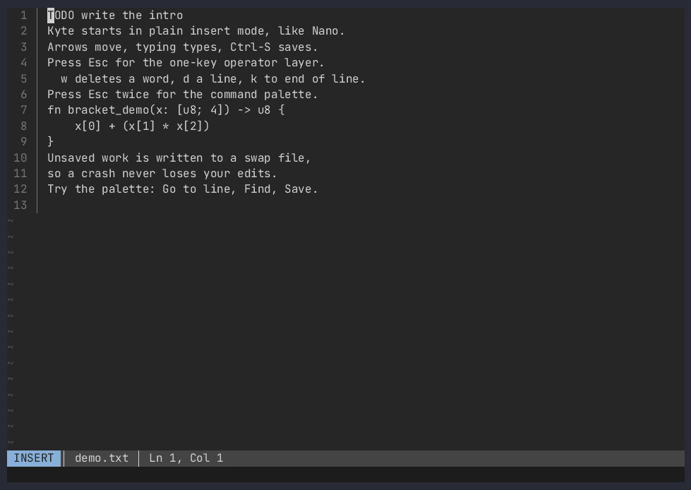

# Kyte

A terminal text editor written in Rust with Ratatui.

- **Comfort first.** Kyte always starts in insert mode, like Nano: typing types, arrows move, Ctrl-S saves, Ctrl-Q quits.
- **Power one key away.** Esc opens a one-key operator layer and shows a legend. Pressing Esc twice opens a command palette.
- **Crash-safe.** Every edit is written to a swap log before it reaches the screen. After a crash, `kill -9` or a power cut, Kyte offers to recover.
- **Every edit kept.** Kyte keeps a file's whole history across sessions. Esc `h` steps back through every edit, and any version can be restored.

MIT License. See [LICENSE](LICENSE).



## Install and build

You need a recent stable Rust toolchain on Linux (Kyte was built and tested with 1.99.1).

```
cargo build --release          # binary at target/release/kyte
target/release/kyte FILE       # open (or create) FILE
cargo test                     # unit, property, file, swap and pty end-to-end tests
```

To install it for your user: `cargo install --path .`, which puts `kyte` in `~/.cargo/bin`.

The Makefile targets are thin wrappers:

| Target | Runs |
| --- | --- |
| `make build` | `cargo build --release` |
| `make test` | `cargo test` |
| `make lint` | `cargo fmt --check` and `cargo clippy --all-targets -- -D warnings` |
| `make e2e` | `cargo test --test e2e` (drives the real binary in a pseudo-terminal) |
| `make demo` | `scripts/demo.sh` (see [Demo](#demo)) |
| `make docker-test` | `cargo test` inside the Docker dev image (see [Docker](#docker)) |

Kyte highlights Rust, Python and Bash files, picked by file extension, using tree-sitter. Building needs a C compiler for the grammars. To leave highlighting out, which also shrinks the binary from about 7 MB to about 1.5 MB:

```
cargo build --release --no-default-features
cargo test --no-default-features
```

Kyte makes no network connections and sends no telemetry. It reads no config file.

## Usage

```
kyte [OPTIONS] [FILE]
```

| Option | Meaning |
| --- | --- |
| `-h`, `--help` | Show usage and exit 0 |
| `-V`, `--version` | Print `kyte 0.2.0` and exit 0 |
| `--esc-ms N` | Double-tap window for Esc Esc in milliseconds (default 300; env `KYTE_ESC_MS`) |
| `--no-kitty` | Never enable the kitty keyboard protocol |
| `--no-history` | Keep no file history this session |
| `--break-lock` | Open FILE even if another Kyte seems to hold it. Only use this if that Kyte is gone. |
| `--print-swap FILE` | Print the text recovered from FILE's swap to stdout and exit 0, or exit 3 if no valid swap exists. Works without a terminal. |

| Exit code | Meaning |
| --- | --- |
| 0 | Normal exit |
| 1 | Runtime error (the message is printed after the terminal is restored) |
| 129, 130, 143 | Stopped by SIGHUP, SIGINT or SIGTERM. The terminal is restored and the swap stays for recovery. |
| 2 | Bad usage, a directory, a FIFO or device, a non-UTF-8 file, stdin or stdout not a terminal, or another live Kyte has the file open |
| 3 | `--print-swap` found no valid swap |

Environment variables: `KYTE_STATE_DIR` (where swap files go; overrides the default), `KYTE_ESC_MS`, and `TERM` as usual.

## Keys

### Insert mode (the default)

| Key | Action |
| --- | --- |
| Printable characters | Insert at the cursor |
| Enter | Start a new line with the same indent |
| Tab | Indent: one tab, or spaces to the next stop, depending on the file. With several lines selected, indent them |
| Shift-Tab | Outdent the current or selected lines |
| Backspace, Delete | Delete the previous or next character (joins lines at line edges). In a file indented with spaces, Backspace in the indent goes back one stop |
| Arrows, Home, End, PageUp, PageDown, Ctrl-Home, Ctrl-End | Move |
| Ctrl-Left, Ctrl-Right (also Alt) | Move by word |
| Ctrl-Backspace, Ctrl-Delete (also Alt) | Delete the word before or after the cursor |
| Shift + any movement key | Select text. Typing, Backspace or Delete then replace or remove it; Esc shows what else you can do with it |
| Ctrl-A | Select all |
| Ctrl-X, Ctrl-C, Ctrl-V | Cut, copy, paste. With nothing selected, cut and copy take the whole line, and a whole line pastes above the current one |
| Ctrl-S | Save. With no file name, Kyte asks for one |
| Ctrl-O | Open another file |
| Ctrl-Q | Quit. With unsaved changes, Kyte asks first: `y` saves and quits, `n` discards, Esc cancels |
| Ctrl-Z, Ctrl-Y | Undo, redo |
| Ctrl-F | Search |
| Ctrl-R | Replace |
| Esc, Ctrl-Space | Open the operator layer |
| Alt-*key* | Same as Esc then *key* |
| Ctrl-K | Open the universal palette |
| Ctrl-P | Open the command palette |

Pasted text (bracketed paste) is inserted as one block and undone with a single Ctrl-Z.

Copy and cut also reach the system clipboard, through the terminal's OSC 52 sequence, for text up to 1 MiB. Your terminal has to allow this; under tmux, set `tmux set -g set-clipboard on`. Terminals don't let programs read the system clipboard by default, so Ctrl-V pastes what you last copied in Kyte, and your terminal's own paste key (usually Ctrl-Shift-V) pastes from the system.

### The Esc layer

Esc never waits. The layer opens at once, the status bar shows `ESC`, and a floating menu lists the keys. It sits in a corner, clear of the cursor.

The next key runs one operator and closes the layer:

| Key | Action |
| --- | --- |
| `w` | Delete to the start of the next word |
| `d` | Delete the current line |
| `k` | Delete to the end of the line (at the end of a line, join the next line) |
| `%` | Jump to the matching bracket (`()`, `[]`, `{}`); shows "No matching bracket" otherwise |
| `/` | Search |
| `u`, `r` | Undo, redo |
| `s` | Save |
| `h` | Open the file's history |
| Esc, within 300 ms of the first Esc | Open the command palette |
| Esc, later | Close the layer |
| Any other key | Close the layer; the key is discarded, nothing is inserted |

The menu changes with where you are, and only lists what works there:

| Where | Extra keys |
| --- | --- |
| On a bracket with a partner | `i` select inside |
| In a file with a line comment syntax | `#` comment or uncomment the line |
| In Rust, Python or Bash | `f` select function, `e` select the syntax under the cursor, `n` and `p` next and previous function |

With text selected, Esc shows the selection's menu instead. Actions leave the result selected where that makes sense, so they chain:

| Key | Action |
| --- | --- |
| `x`, `c` | Cut, copy |
| `/`, `R` | Search for it, replace it |
| `#` | Comment or uncomment the lines |
| `U`, `L` | Uppercase, lowercase |
| `S` | Sort the lines |
| `e` | Expand to the next larger piece of syntax |
| Esc | Clear the selection |

So Esc `f` then Esc `x` cuts a function, and Esc `e` then Esc `e` grows the selection outward.

Each operator is one undo step. Alt-d on a terminal that sends `ESC d` behaves exactly like Esc then `d`. If your terminal or multiplexer delays or eats Esc, use Ctrl-Space for the layer and Ctrl-P for the palette. If the 300 ms window is too short or too long, set `--esc-ms N` or `KYTE_ESC_MS`.

Under tmux, set `tmux set -g escape-time 10`. tmux's default of 500 ms delays every lone Esc.

### Command palette

Esc Esc (or Ctrl-P) opens a fuzzy-filtered list. Type to filter, Up and Down to select, Enter to run, Esc to close without running anything.

Commands: Save, Save as, Open file, Quit, Quit without saving, Undo, Redo, Cut, Copy, Paste, Select all, Find, Replace, Go to line, Toggle line numbers, Toggle tabs and spaces, Show key help.

Kyte works out whether a file indents with tabs or spaces, and how many, from its first 10,000 lines. A file with no indent uses tabs. The status bar shows `Spaces N` for space-indented files. **Toggle tabs and spaces** changes what new indent uses until the file is closed; it doesn't rewrite existing lines.

**Save as** asks for a file name, starting from the current one; `~/` means your home directory, and Tab completes the path. It asks before overwriting a file, and refuses a file another Kyte has open. The buffer then belongs to the new file, and the old file stays as it was.

**Open file** (Ctrl-O) asks for a path, starting in the current file's directory. Tab completes it, and lists the matches in a floating box when there's more than one. A path that doesn't exist yet opens as a new file. Kyte holds one file at a time, so opening another replaces the current one, and if you have unsaved changes it asks first: `y` saves them, `n` discards them, Esc cancels. If the new file left a crashed session behind, Kyte offers to recover it; quitting that offer closes Kyte.

**Go to line** asks for a 1-based line number. Numbers past the end go to the last line, and anything that is not a number shows an error. **Show key help** shows the key table; Up and Down scroll it, and Esc closes it.

### Universal palette

Ctrl-K opens one box for getting anywhere. Type to search commands and files together, or start with a marker:

| You type | Kyte offers |
| --- | --- |
| Part of a command or file name | Matching commands and files. A command wins a tie |
| `:42` | Go to line 42 |
| `/text` | Search for `text` |

Files are listed from the directory you started Kyte in, nearest first. Hidden files, `target` and `node_modules` are left out, and the list stops at 20,000 files or 100 ms, so a very large directory shows only part of its tree. Choosing a file works like Ctrl-O, including the question about unsaved changes.

### File history

Kyte keeps every edit to a file, across sessions, including edits you later undo or discard. A version that a save replaced from outside Kyte is kept too. Esc `h` (or **File history** in the palette) opens a read-only view of the file's past, starting at the newest version. What each step added is selected, and a floating menu lists the keys.

| Key | Action |
| --- | --- |
| Left, Right | One edit older or newer |
| Up, Down | One burst of work older or newer (edits stop being a burst after a 3 second gap or a save) |
| PageUp, PageDown | The previous or next saved version |
| Home, End | The first or newest version |
| Enter | Restore this version. It comes back as one undo step, and the file changes only when you save |
| Esc, `q` | Close, back to your text |

History is stored under `$XDG_STATE_HOME/kyte/history/` (default `~/.local/state/kyte/history/`), one log per file, with mode 0600 in a 0700 directory. It's kept by path, so a renamed file starts a new history; Save as does too. A buffer with no file name has no history until it's saved. Nothing is written until your first edit, so reading a file leaves no trace.

A million typed characters take about 34 MB, and a pasted block adds its own size. **It keeps everything you type, in plain text, with no limit on size.** That includes a password you typed and then deleted. **Delete file history** in the palette removes one file's log, and `--no-history` keeps none for a session. Use `--no-history` for files holding secrets.

### Search

Ctrl-F (or Esc `/`) opens `Search:` on the message line, starting from the selected text if there is any. Kyte jumps to the first match as you type and highlights every match on screen. Enter, Down or Ctrl-F jumps to the next match and Up to the previous one, wrapping around. Esc closes the prompt and leaves the cursor on the match, or puts it back where it was if nothing matched.

Search ignores case until your text has a capital letter, then it matches exactly: `hello` finds `Hello`, and `Hello` doesn't find `hello`.

### Replace

Ctrl-R asks what to replace and what to replace it with. Kyte then starts at the cursor, goes to the end of the file, wraps to the top, and stops where it started. At each match, `y` replaces it, `n` skips it, `a` replaces all the rest as one undo step, and Esc or `q` stops. Replace matches case the same way search does.

## Swap files and recovery

- When you open a file, Kyte creates a swap file under `$XDG_STATE_HOME/kyte/swap/` (default `~/.local/state/kyte/swap/`; `KYTE_STATE_DIR` overrides it). It is never placed next to your file. It has mode 0600 and is named after the escaped absolute path, for example `%2Fhome%2Fme%2Fnotes.txt.kyteswp`. A name that would be too long keeps the end of the path and adds a hash.
- Each edit is appended to the swap as a small checksummed record before the screen updates. The swap is fsynced at most once per second. Your real file changes only when you save.
- The first edit also copies the file's content into the swap, so your edits can be recovered even if the file later changes or disappears. Opening a file without editing it copies nothing.
- Saving is atomic. Kyte writes a temporary file in the same directory, fsyncs it, gives it the file's permissions, owner and extended attributes (which include SELinux labels and ACLs), renames it over the original and fsyncs the directory. A failed save (for example in a read-only directory) leaves the original untouched, shows the error and keeps your changes and the swap. Saving through a symlink updates the target and keeps the link.
- A file with hard links, or one whose owner or attributes the temporary file can't take on, is rewritten in place so it stays the same file. Kyte keeps a backup beside it during the write and restores the old content if the write fails.
- If the file changed on disk since you opened or last saved it, Ctrl-S asks before overwriting. The check compares content, so a rewrite of the same bytes doesn't count. A read-only file also needs a `y` before Kyte replaces it. `n` or Esc cancels either question.
- After a save, the swap starts over empty. After a clean quit, the swap is deleted.
- A buffer with no file name has a swap too, named `untitled-<pid>-<start>.kyteswp`. After a crash, running `kyte` with no file offers to recover the newest one.
- If a save fails, your changes stay in the editor and the swap. The error points you to Save as in the palette, which writes them elsewhere. Quitting after a failed save still asks first; only `n` discards.
- If Kyte finds a swap with unsaved changes when you open the file, it shows **Recover unsaved changes**:
  - `r` recovers the changes into the editor, marked unsaved. Ctrl-S writes them.
  - `d` discards them and opens the file as it is on disk.
  - `q` or Esc quits and changes nothing.
- If the swap can't be written, or there isn't one, the status bar shows `no crash recovery` until a save starts a working one.
- A damaged tail (for example a record cut off by a crash) is dropped, and everything before it is recovered.
- If the file changed on disk after the swap was written, Kyte says so and still offers to recover your version. Recovering shows your version in the editor; the file on disk changes only when you save.
- A swap Kyte can't read is **stale**: Kyte offers only discard or quit.
- If another running Kyte has the file open, a second `kyte FILE` exits 2 and names that process's PID. The check includes the process's start time, so a reused PID doesn't count. `--break-lock` overrides it.
- `kyte --print-swap FILE` prints what would be recovered, without a terminal.

## Demo

```
make demo        # or ./scripts/demo.sh
```

The demo runs headless, with no display and no tmux. It builds the release binary, then `cargo run --release --example demo` drives Kyte in a pseudo-terminal at 100x30 through the storyboard: open, type, legend, `w`, `d`, undo, palette, go to line, search, save, `kill -9`, recover, quit. It writes to `docs/demo/`:

- `demo.cast`: an asciicast v2 recording (`asciinema play docs/demo/demo.cast`)
- `frames/NN-step.txt`: the screen text at each step
- `steps.tsv`: the step times
- `demo.gif`: rendered with [agg](https://github.com/asciinema/agg) if it is installed
- `demo.mp4` and `NN-step.png` screenshots: made with ffmpeg from the gif

If agg or ffmpeg is missing, the script still writes the cast and the text frames and prints which artifacts it skipped. `DEMO_OUT=dir` writes somewhere else. `cargo test --test demo -- --ignored` runs the same script as a test.

## Docker

Docker is optional; plain cargo is the primary path. The `Dockerfile` has three stages: `dev` (Rust, tmux, ffmpeg, fonts and agg), `build`, and a small `runtime` image.

```
docker build --target dev -t kyte-dev .
docker run --rm -v "$PWD":/src:Z -w /src kyte-dev cargo test
docker run --rm -it -v "$PWD":/src:Z -w /src kyte-dev cargo run -- /tmp/try.txt
make docker-test                 # the same test run
docker compose run --rm dev make demo
```

On SELinux-enforcing systems such as Fedora, a bind mount needs the `:Z` suffix so the container may read it. The Makefile adds it by default (`MOUNT_SUFFIX ?= :Z`), and `docker-compose.yml` uses `./:/src:Z`. Leave SELinux enforcing; relabel the mount instead. On hosts without SELinux the suffix is harmless, or set `MOUNT_SUFFIX=`.

These Docker files have not been run yet, because the build machine had no Docker (see `docs/DECISIONS.md`).

## Known limitations

- **Split escape sequences.** On a legacy terminal over a laggy link, the bytes of an arrow key can arrive split, so the Esc arrives alone. If the rest arrives within 150 ms, Kyte discards it: that key press does nothing, and nothing is typed. If it arrives later than that, its characters are typed as text. Terminals with the kitty keyboard protocol do not have this problem, and Kyte enables the protocol when it is available.
- UTF-8 files only (others are refused and left untouched).
- Kyte keeps each line's ending as it is. New lines use the ending most of the file uses, and the status bar shows `CRLF` for those files. It doesn't convert a file from one to the other. A `\r` that isn't part of a line ending shows as a control picture.
- Linux only (the swap lock checks `/proc`).
- Files over 512 KiB aren't syntax highlighted, because each keystroke re-parses the file. Typing near that size takes up to about 55 ms per key.
- Search takes under about 30 ms per key on a 38 MB ASCII file. On a file that size with non-ASCII text, ignoring case takes about 240 ms per key.
- A very long single line costs more per keystroke, depending on what's in it. At the end of a 5 MB line on the build machine, plain ASCII takes about 8 ms, a line full of tabs about 45 ms, and CJK text about 170 ms.
- Not in this version: reader mode, file tree, light and high-contrast themes, mouse, multiple buffers or splits, LSP, plugins, a config file, soft wrap, CRLF conversion, non-UTF-8 files, RPM/COPR packaging, and use as the default `$EDITOR`.

## Documentation

- `docs/ARCHITECTURE.md`: the design specification
- `docs/DECISIONS.md`: deviations from the specification and resolved crate versions
- `docs/ACCEPTANCE.md`: the acceptance criteria and how each one was verified
- `docs/KEY_LAB.md`: measured key bytes and event sequences

MIT License. See [LICENSE](LICENSE).
