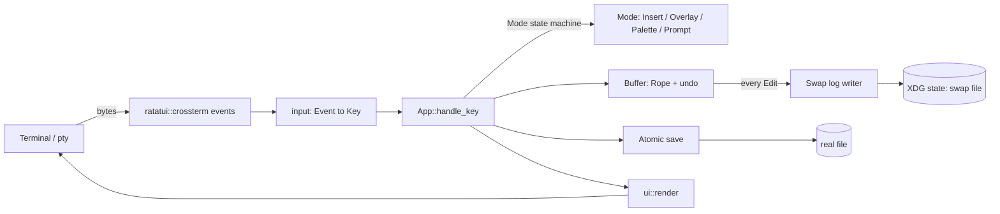
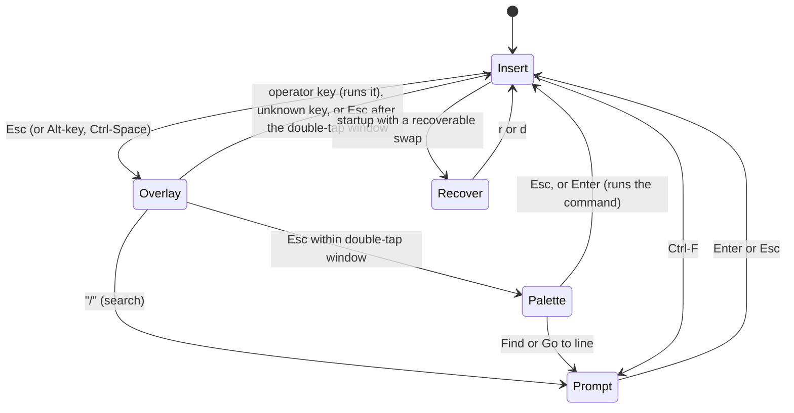

**Status:** The original design for Kyte's first build, kept for history. `README.md` describes how Kyte works today, and `docs/DECISIONS.md` records every change from this design and why.

## 1\. Goal, MVP scope and non-goals

Kyte is a terminal text editor. It starts in plain always-insert mode like Nano. Pressing Esc opens a short-lived operator layer: one keystroke does a bulk edit, and a legend of the available keys shows only while that layer is open. Double-tapping Esc opens a command palette. Unsaved work survives a crash.

The MVP must be small enough to build and verify quickly, and every behavior in it must be checkable headlessly through a pseudo-terminal (pty).

### In the MVP

- Edit one UTF-8 file, always in insert mode: type, Enter, Tab, Backspace, Delete, arrows, Home/End, PageUp/PageDown, Ctrl-Home/Ctrl-End, bracketed paste, window resize.
- In-session undo and redo (typed characters coalesce; each operator is one undo step).
- Esc operator overlay with legend: delete word, delete line, delete to end of line, jump to matching bracket, search, undo, redo, save.
- Double-tap Esc command palette with fuzzy filtering, plus a go-to-line prompt.
- Incremental search.
- Crash safety: a swap file written on every edit, recovery prompt on next open, atomic explicit save.
- Dashboard basics: line-number gutter, status bar, message line, one dark theme.
- CLI: `kyte [FILE]`, `--help`, `--version`, `--esc-ms`, `--no-kitty`, `--print-swap FILE`.
- A scripted, headless demo that records a terminal recording and screenshots (section 12).

### Stretch (only after every acceptance criterion in section 10 passes)

- tree-sitter syntax highlighting behind a cargo feature `highlight` (task T13).

### Explicitly out of the MVP (do not build; later phases)

Reader mode and idle auto-activation, file tree, Ctrl-K universal palette, light and high-contrast themes, undo history that survives restart, mouse, selection and clipboard (the system clipboard and OSC 52), multiple buffers or splits, LSP, plugins, config file, soft wrap, CRLF conversion, non-UTF-8 files, RPM/COPR packaging, making Kyte the default `$EDITOR`. Where a later phase needs a hook, section 13 says where it plugs in.

### Deviations from the original concept (all deliberate)

- "Ratatouille" is not a Rust crate; the TUI library is **Ratatui**.
- The hidden swap file lives under the XDG state directory, not next to the file (avoids `git status` noise and read-only directories).
- Persistent undo, reader mode, file tree, Ctrl-K and extra themes are deferred.
- The overlay is one-shot: it closes after one operator.

## 2\. System overview



Mode state machine (this is the heart of the product; unit-test it with injected timestamps):



## 3\. Tech stack and reasons

| Piece | Choice | Why |
| --- | --- | --- |
| Language | Rust, stable toolchain (current stable, edition 2021 or 2024) | Single static-ish binary, fast start. |
| TUI | ratatui 0.30.x (latest 0.30) | Maintained, has TestBackend so rendering is unit-testable. Use the re-exported ratatui::crossterm so versions can never mismatch (research says crossterm 0.29). If the re-export is missing, add crossterm = "0.29" and pin it. |
| Text buffer | ropey 1.6 | Mature rope with char and line indexing. |
| Text units | unicode-segmentation, unicode-width | Cursor moves by grapheme; rendering uses display width. |
| Swap checksums | crc32fast | Tiny, enough to detect torn writes. |
| Errors | anyhow | Binary-level error plumbing only. |
| CLI | hand-written arg parsing (about 40 lines) | Avoids clap compile time and size for 6 flags. |
| Dev-only | tempfile, proptest, portable-pty, vt100 | Temp dirs, property tests for the buffer, and a headless pty + terminal-emulator harness for end-to-end tests and the demo. |
| Fuzzy match | own 30-line subsequence scorer | No dependency needed for about 10 palette commands. |
| Stretch only | tree-sitter, tree-sitter-highlight 0.27 plus a few grammar crates | Feature-flagged so the MVP builds without any grammar. |

Do not add anything else without a written reason in `docs/DECISIONS.md`. When a version does not resolve, take the newest compatible one and record it there.

Hard rules: no network access at runtime, no secrets anywhere, no telemetry. Linux only for the MVP (it may use `/proc` to check whether a PID is alive).

## 4\. Repo, naming and layout

- Repository: `zypher-systems/kyte` on GitHub.
- Cargo package name `kyte-editor` (the `kyte` crate name is taken on crates.io). Library target named `kyte`, binary named `kyte`.
- No license file yet (put "All rights reserved, license TBD" in the README).

```
kyte/
  Cargo.toml                 # [package] name="kyte-editor"; [lib] name="kyte"; [[bin]] name="kyte"
  Dockerfile                 # targets: dev (default), runtime
  docker-compose.yml         # service "dev" with source bind mount and a cargo cache volume
  Makefile                   # build test lint e2e demo docker-test (thin wrappers)
  README.md
  docs/
    DECISIONS.md             # every deviation from this design, with a reason
    KEY_LAB.md               # results of task T1
    demo/                    # outputs of task T11 (cast, gif, mp4, png, frames/*.txt)
  scripts/
    demo.sh                  # runs the demo example and renders gif/mp4/png
    demo-tmux.sh             # optional tmux-based alternative
  src/
    main.rs                  # args, tty check, exit codes, calls kyte::run
    lib.rs                   # pub mod declarations, pub fn run(opts) -> Result<ExitCode>
    cli.rs                   # Options parsing
    app.rs                   # App state, Mode, handle_key / handle_event, tick
    input.rs                 # crossterm Event -> Key; Alt normalization
    command.rs               # Command enum, palette registry, parse of "go to line"
    buffer.rs                # Buffer, Edit, undo/redo, cursor motion
    ops.rs                   # operator implementations (pure functions over &Rope)
    search.rs                # incremental search over a Rope
    palette.rs               # fuzzy scorer, palette state
    swap.rs                  # swap log: format, writer, replay, lock
    fileio.rs                # open (UTF-8 check), atomic save, state dir
    term.rs                  # TerminalGuard (raw mode, alt screen, paste, kitty flags, panic hook)
    ui/mod.rs                # render(&App, &mut Frame)
    ui/text_view.rs          # gutter, scrolling, tabs, wide chars, cursor position
    ui/chrome.rs             # status bar, message line, legend, palette popup, recover modal
    ui/theme.rs              # Theme struct + DARK constant
  examples/
    keylab.rs                # raw key-event logger (task T1)
    demo.rs                  # scripted demo driver using the pty harness (task T11)
  tests/
    common/mod.rs            # pty harness: spawn, send, wait_for, screen, kill, resize, record cast
    buffer_props.rs          # proptest
    fileio.rs                # atomic save tests
    swap.rs                  # swap format, torn tail, replay
    e2e.rs                   # pty scenarios, one #[test] per acceptance criterion group
```

One crate, no workspace, so it builds with a single `cargo build`.

## 5\. Key handling and Esc disambiguation

### 5.1 The problem

In legacy terminal encoding a lone Esc byte is also the first byte of arrows, Home, F-keys and Alt chords, so no program can know instantly whether Esc is a keypress. Terminals that support the kitty keyboard protocol report Esc unambiguously.

### 5.2 Approach (decided, do not redesign)

1. **Use crossterm's own parser.** It reads available bytes and emits a lone Esc event when nothing follows. Kyte adds no byte-level parsing of its own.
2. **Enable the kitty protocol when available.** At startup, if `supports_keyboard_enhancement()` returns true and `--no-kitty` is not set, push `KeyboardEnhancementFlags::DISAMBIGUATE_ESCAPE_CODES` and nothing else (no release events). Pop it on exit and in the panic hook. Only handle `KeyEventKind::Press` and `Repeat`.
3. **The overlay opens instantly on Esc.** Nothing waits for the double-tap window.
4. **The double-tap window decides palette versus cancel.** In Overlay mode, a second Esc arriving within `esc_ms` of the first opens the palette; a second Esc after the window just closes the overlay. Default 300 ms, set by `--esc-ms N` or `KYTE_ESC_MS`.
5. **Alt chords are Esc plus a key.** crossterm reports Esc followed immediately by `x` as Alt-x on legacy terminals. Normalize `Alt(c)` in Insert mode into the sequence `Esc`, then `Char(c)`, so Alt-d behaves exactly like Esc then d. This turns the ambiguity into a feature.
6. **Alternate overlay key: Ctrl-Space** (reported by crossterm as Ctrl plus space) for people whose terminal or multiplexer mangles Esc. Palette alternative: Ctrl-P.
7. **Known limitation, document it:** on a legacy terminal over a laggy link, an arrow key's bytes can be split so the Esc arrives alone; the user then sees the overlay open and an unknown key close it (the stray characters are discarded in the overlay, never inserted). Do not try to heal this in the MVP; record the observed behavior in `docs/KEY_LAB.md`.
8. tmux has its own `escape-time` (default 500 ms) which delays a lone Esc. Scripts and docs that drive Kyte through tmux must run `tmux set -g escape-time 10`.

### 5.3 Types and signatures

```
// input.rs
#[derive(Debug, Clone, PartialEq, Eq)]
pub enum Key {
    Char(char), Enter, Tab, Backspace, Delete, Esc,
    Left, Right, Up, Down, Home, End, PageUp, PageDown,
    CtrlHome, CtrlEnd,
    Ctrl(char),        // lowercase letter; Ctrl-Space is Ctrl(' ')
    Alt(char),
    F(u8),
}

pub enum Input { Key(Key), Paste(String), Resize(u16, u16) }

/// None for events Kyte ignores (key release, mouse, focus).
pub fn map_event(ev: ratatui::crossterm::event::Event) -> Option<Input>;
/// Alt(c) in Insert mode becomes [Esc, Char(c)]; every other key passes through.
pub fn normalize(key: Key, mode_is_insert: bool) -> Vec<Key>;
```

```
// app.rs
pub struct App {
    pub buffer: Buffer,
    pub mode: Mode,
    pub message: Option<String>,      // shown on the message line until the next key
    pub show_line_numbers: bool,
    pub esc_window: Duration,         // default 300 ms
    pub quit: bool,
    // private: swap: Option<SwapWriter>, viewport scroll, last_fsync: Instant, ...
}

pub enum Mode {
    Insert,
    Overlay { opened_at: Instant },
    Palette(PaletteState),
    Prompt(Prompt),                   // search, go to line, confirm-quit
    Recover(RecoverInfo),             // modal at startup
}

pub enum Prompt {
    Search { query: String, origin: usize },   // origin = cursor to restore on Esc
    GotoLine { text: String },
    ConfirmQuit,
}

impl App {
    pub fn new(buffer: Buffer, swap: Option<SwapWriter>, opts: &Options) -> App;
    /// Pure with respect to the clock: `now` is injected so tests control time.
    pub fn handle_key(&mut self, key: Key, now: Instant) -> Result<()>;
    pub fn handle_paste(&mut self, text: String) -> Result<()>;
    /// Called when the poll timeout elapses with no input. fsyncs a dirty swap at most once per second.
    pub fn tick(&mut self, now: Instant) -> Result<()>;
}

// lib.rs
pub fn run(opts: Options) -> anyhow::Result<std::process::ExitCode>;
```

### 5.4 Key bindings (the complete MVP table)

| Mode | Key | Action |
| --- | --- | --- |
| Insert | printable char, Enter, Tab (inserts a real tab) | insert at the cursor |
| Insert | Backspace, Delete | delete previous or next grapheme (joins lines at line edges) |
| Insert | Left, Right, Up, Down, Home, End, PageUp, PageDown, Ctrl-Home, Ctrl-End | move; Home goes to line start, End to line end |
| Insert | Ctrl-S (alias Ctrl-O) | save |
| Insert | Ctrl-Q (alias Ctrl-X) | quit; if dirty, ask for confirmation |
| Insert | Ctrl-Z, Ctrl-Y | undo, redo |
| Insert | Ctrl-F | search prompt |
| Insert | Esc, Ctrl-Space, Alt-key | open the overlay (Alt-key also runs that key) |
| Insert | Ctrl-P | open the palette directly |
| Overlay | w | delete word forward |
| Overlay | d | delete current line |
| Overlay | k | delete to end of line |
| Overlay | % | jump to matching bracket |
| Overlay | / | search prompt |
| Overlay | u, r | undo, redo |
| Overlay | s | save |
| Overlay | Esc within esc_ms of opening | open the palette |
| Overlay | Esc after esc_ms | close the overlay |
| Overlay | any other key | close the overlay, discard the key, no edit |
| Palette | typing, Backspace | filter query |
| Palette | Up, Down, Enter, Esc | select, run, close |
| Prompt | Enter, Esc | run/confirm, cancel |
| Search prompt | typing | incremental jump to the first match at or after origin |
| Search prompt | Enter | jump to the next match after the current one, wrapping, and keep the prompt open |
| Search prompt | Esc | close the prompt and leave the cursor on the current match; if nothing matched, restore origin |
| ConfirmQuit | Ctrl-Q or y | quit, discarding changes (the swap is deleted) |
| ConfirmQuit | any other key | cancel |

The legend text, shown on the message line only while Mode is Overlay, is exactly: `w del word d del line k del to end % bracket / search u undo r redo s save Esc Esc palette` (the status bar shows `ESC` instead of `INSERT` at the same time). The spacing may be shortened, but each key letter and its label must stay.

Palette commands (MVP): Save, Quit, Quit without saving, Undo, Redo, Find, Go to line, Toggle line numbers, Show key help. "Go to line" opens a `GotoLine` prompt; "Show key help" shows the key table above in a modal box (must close on Esc).

## 6\. Data models

```
// buffer.rs
/// A single replace operation in char indices. The inverse swaps `removed` and `inserted`.
#[derive(Debug, Clone, PartialEq, Eq)]
pub struct Edit {
    pub at: usize,          // char index into the rope
    pub removed: String,
    pub inserted: String,
}

pub struct Buffer {
    rope: ropey::Rope,
    path: Option<std::path::PathBuf>,   // canonical target path if the file exists or was given
    cursor: usize,                      // char index, always on a grapheme boundary
    want_col: usize,                    // remembered display column for Up/Down
    dirty: bool,                        // differs from last saved/loaded content
    undo: Vec<Group>,
    redo: Vec<Group>,
    pending_edits: Vec<Edit>,           // drained by the app after every command and appended to the swap
}

struct Group { edits: Vec<Edit>, cursor_before: usize, cursor_after: usize, kind: GroupKind }
enum GroupKind { Typing, Operator, Paste, Other }

impl Buffer {
    pub fn from_str(text: &str, path: Option<PathBuf>) -> Buffer;
    pub fn to_string(&self) -> String;
    pub fn len_chars(&self) -> usize;
    pub fn line_count(&self) -> usize;
    pub fn cursor(&self) -> usize;
    pub fn line_col(&self) -> (usize, usize);       // 1-based (line, grapheme column), for the status bar
    pub fn apply(&mut self, edit: Edit, kind: GroupKind);  // records undo, marks dirty, queues for swap
    pub fn insert_str(&mut self, s: &str, kind: GroupKind);
    pub fn backspace(&mut self);
    pub fn delete_forward(&mut self);
    pub fn undo(&mut self) -> bool;
    pub fn redo(&mut self) -> bool;
    pub fn move_left(&mut self); pub fn move_right(&mut self);
    pub fn move_up(&mut self);   pub fn move_down(&mut self);
    pub fn move_home(&mut self); pub fn move_end(&mut self);
    pub fn move_to(&mut self, char_idx: usize);
    pub fn take_pending_edits(&mut self) -> Vec<Edit>;
    pub fn mark_clean(&mut self);                   // after a successful save
}
```

Rules:

- Text is stored exactly as read: no newline conversion, `\r` stays an ordinary character, a missing trailing newline stays missing. A file that is not valid UTF-8 is refused (never lossy-converted).
- Typing coalescing: consecutive `Typing` edits that are adjacent on one line and not separated by a newline or a cursor move form one undo group. Operators, paste, Enter and undo/redo each close the current group.
- Undo and redo are themselves applied through `apply` bookkeeping so the swap log stays a pure forward log (replay needs no undo knowledge).

```
// ops.rs  (pure: take &Rope and a cursor, return the edit or the target index)
pub fn word_end(rope: &Rope, from: usize) -> usize;       // for `w`
pub fn line_range(rope: &Rope, at: usize) -> Range<usize>; // for `d`
pub fn eol(rope: &Rope, at: usize) -> usize;               // for `k`
pub fn match_bracket(rope: &Rope, at: usize) -> Option<usize>;  // for `%`
```

Operator semantics (exact, so they can be verified):

| Op | Definition | Example (▮ is the cursor) |
| --- | --- | --- |
| w | Delete from the cursor to the start of the next word. Classes are word chars (alphanumeric and _), punctuation, whitespace. Skip the rest of the current class run, then following whitespace. At end of buffer do nothing. | foo▮ bar baz becomes foo▮bar baz; ▮foo bar becomes ▮bar |
| d | Delete the whole current line including its newline. If it is the last line and has no trailing newline, also delete the preceding newline (unless it is the only line, which becomes empty). Cursor lands at the same column on the following line, clamped. | a\nb▮b\nc becomes a\n▮c |
| k | Delete from the cursor to the end of the line, not including the newline. If already at end of line, delete the newline (join with the next line). | ab▮cd\nef becomes ab▮\nef; ab▮\nef becomes ab▮ef |
| % | If the cursor is on ()[]{}, jump to its partner counting nesting; if it is not on a bracket, search forward on the current line for the first bracket; no string or comment awareness; unmatched or none gives the message "No matching bracket" and no move. | ▮(a[b]c) jumps to the last ) |

Note on `w`: with the cursor right after `foo` (on the space), `w` deletes only the whitespace run up to the next word start. With the cursor at the start of `foo bar`, `w` deletes `foo` (the word and the whitespace after it). The unit tests in T6 pin these cases.

### Swap file format (little-endian)

```
Header
  magic        8 bytes  "KYTESWP1"
  version      u32      1
  pid          u32      writer PID (fixed offset 12; rewritten when a recovered swap is adopted)
  base_len     u64      byte length of the real file when the swap was created (0 if the file did not exist)
  base_crc     u32      CRC32 of those bytes
  path_len     u32
  path         bytes    canonical absolute path of the target file (UTF-8)
Record (repeated, append-only)
  rec_len      u32      length of the payload
  rec_crc      u32      CRC32 of the payload
  payload      kind: u8 (0 = edit; reserved for later record kinds) | at: u64 (char index) | del_chars: u64 | ins_len: u32 | ins: UTF-8 bytes
```

- Replay: start from the real file content (its CRC must equal `base_crc`), apply each record in order, stop at the first short or CRC-bad record and treat everything before it as valid (a torn tail from a kill is expected, not an error).
- Location: `$KYTE_STATE_DIR` if set, else `$XDG_STATE_HOME/kyte/swap/`, else `~/.local/state/kyte/swap/`. File name: the canonical absolute path with every `/` replaced by `%2F` and every `%` by `%25`, plus `.kyteswp`. Create directories with mode 0700 and the swap with mode 0600.
- A buffer with no path (new file given on the command line that does not exist yet) still gets a swap, keyed by the intended absolute path.

### Core public API of the other modules

```
// fileio.rs
pub struct Loaded { pub text: String, pub existed: bool, pub mode: Option<u32> }
pub fn load(path: &Path) -> Result<Loaded, OpenError>;          // OpenError::{NotUtf8, IsDirectory, Io}
/// temp file in the same directory, write, fsync, copy permissions, rename over the target
/// (resolving symlinks first), fsync the directory. On any error the original is untouched.
pub fn save_atomic(path: &Path, text: &str) -> std::io::Result<()>;
pub fn state_dir() -> PathBuf;

// swap.rs
pub struct SwapWriter { /* file handle, pending-fsync flag */ }
impl SwapWriter {
    pub fn create(target: &Path, base: &[u8]) -> io::Result<SwapWriter>;   // fails with LiveLock if a live PID owns it
    pub fn adopt(swap_path: &Path) -> io::Result<SwapWriter>;              // after recovery: rewrites pid, keeps appending
    pub fn append(&mut self, edits: &[Edit]) -> io::Result<()>;            // write() immediately, no fsync
    pub fn fsync_if_pending(&mut self) -> io::Result<()>;
    pub fn remove(self) -> io::Result<()>;                                 // after explicit save or discard
}
pub enum SwapStatus { None, Recoverable(RecoverInfo), Stale, LiveLock { pid: u32 } }
pub fn inspect(target: &Path, current_file_bytes: &[u8]) -> io::Result<SwapStatus>;
pub fn replay(base: &str, swap_path: &Path) -> io::Result<String>;         // used by recovery and --print-swap

// term.rs
pub struct TerminalGuard;    // enters raw mode, alternate screen, bracketed paste, optional kitty flags
impl TerminalGuard { pub fn enter(no_kitty: bool) -> io::Result<TerminalGuard>; }
impl Drop for TerminalGuard { /* leaves everything, always */ }
pub fn install_panic_hook();  // restores the terminal before printing the panic

// cli.rs
pub struct Options { pub file: Option<PathBuf>, pub esc_ms: u64, pub no_kitty: bool, pub print_swap: Option<PathBuf> }
pub fn parse(args: impl Iterator<Item = String>) -> Result<Options, CliError>;
```

Write-ahead behavior: after every command, `App` drains `buffer.take_pending_edits()` and calls `SwapWriter::append` (a plain `write`, so the data is in the kernel and survives `kill -9`). `tick` calls `fsync_if_pending` at most once per second so power loss loses at most about a second. Explicit save: `save_atomic`, then `buffer.mark_clean()`, then `SwapWriter::remove` and a fresh swap for the new base.

## 7\. CLI, exit codes and environment

`kyte [OPTIONS] [FILE]`

| Option | Meaning |
| --- | --- |
| -h, --help | usage, exit 0 |
| -V, --version | prints kyte 0.1.0 (use the crate version), exit 0 |
| --esc-ms N | double-tap window in ms (default 300; env KYTE_ESC_MS) |
| --no-kitty | never enable the kitty keyboard protocol |
| --print-swap FILE | print the content recovered from FILE's swap to stdout and exit 0; exit 3 if there is no valid swap. Needs no tty. Exists so tests can verify recovery without a terminal. |

| Exit code | Meaning |
| --- | --- |
| 0 | normal exit |
| 1 | runtime error (message on stderr after the terminal is restored) |
| 2 | bad usage, directory given, non-UTF-8 file, stdin or stdout not a tty (except --help, --version, --print-swap), another live Kyte owns the swap |
| 3 | --print-swap found no swap |

Environment: `KYTE_STATE_DIR` (swap directory override, used by tests), `KYTE_ESC_MS`, `TERM` as usual. No other configuration in the MVP.

## 8\. Key flows

1. **Open.** Parse args, require a tty. If `FILE` given: `fileio::load` (refuse on non-UTF-8 or directory). `swap::inspect`: `None` leads to a normal start; `Recoverable` shows the Recover modal; `Stale` (the real file changed since the swap was made) shows a modal offering only discard or quit; `LiveLock` exits with code 2 and a clear message.
2. **Recover modal** (a centered box over the empty text view): `r` replays the swap into the buffer (marked dirty), adopts the swap, and continues; `d` deletes the swap and opens the file as it is; `q` or Esc quits without touching anything. The modal names the file and the swap's modification time.
3. **Edit.** Each key goes to `App::handle_key`; the buffer queues edits; the app appends them to the swap; the UI redraws after every handled input or resize.
4. **Overlay operator.** Esc, then one letter, runs the operator as one undo group, returns to Insert, and the legend disappears on the next redraw.
5. **Palette.** Esc Esc within the window, type to filter (subsequence match, higher score for prefix and consecutive matches, ties broken by registry order), Enter runs the top-selected command.
6. **Save.** Ctrl-S runs `save_atomic`. Success shows "Saved N lines" on the message line, clears the dirty flag, removes and recreates the swap. Failure shows the OS error, keeps the buffer dirty, and keeps the swap. A buffer with no path and no `FILE` argument cannot exist (the MVP requires `FILE`; running `kyte` with no file opens an empty buffer that is "Untitled" and Ctrl-S shows "No file name; start Kyte with a file path" without crashing).
7. **Quit.** Ctrl-Q on a clean buffer removes the swap (nothing to protect) and exits 0. On a dirty buffer it enters ConfirmQuit; Ctrl-Q or `y` discards and exits, anything else cancels.
8. **Crash.** The process dies; the swap holds every edit that reached `write()`. The next `kyte FILE` shows the Recover modal.
9. **Resize and paste.** Resize re-renders and keeps the cursor visible. Bracketed paste inserts as one `Paste` undo group.

## 9\. UI layout

```
 1 │ fn main() {                       <- text area: gutter (line numbers) + text, scrolls vertically and horizontally
 2 │     println!("hi");
 ~
 INSERT │ main.rs [+] │ Ln 2, Col 5        <- status bar: mode, file name, dirty marker [+], position (reverse video)
 Saved 2 lines                             <- message line: messages, prompts, and the legend while the overlay is open
```

- The bottom two rows are always the status bar and the message line, so opening the legend never shifts the text.
- Palette: centered popup, up to 8 result rows plus the input line, drawn over the text.
- Tabs render to the next multiple of 4 columns; wide characters use `unicode-width`; the terminal cursor is placed at the cursor's display position.
- Themes: each `ThemeName` has a set of colors in 24-bit color and another in indexed 256-color values, and a `Theme` is built from one of them. `COLORTERM=truecolor` or `24bit` picks the first; anything else, including the pty tests and demo, gets the second. Provide fields for text, gutter, status bar, message, legend, palette box, selected row, error. Later themes are just more sets of colors.
- Minimum terminal size 20x5; below that, draw "terminal too small" instead of panicking.
- No animation, no timers that repaint: the screen only changes on input, resize or message expiry on the next key. This keeps recordings and screenshots deterministic.

## 10\. Acceptance criteria (verified by running the program)

IDs are stable; each maps to tests in `tests/e2e.rs` or the other test files (name the test after the ID, for example `ac05_esc_shows_legend_instantly`). "Screen" means the vt100-emulated screen text of a pty running the real `kyte` binary at 100x30 with `TERM=xterm-256color`, `KYTE_STATE_DIR` set to a temp dir, and `--no-kitty`.

**Build and basics**

- **AC-01** `cargo build --release` succeeds with no warnings. `target/release/kyte --version` prints `kyte 0.1.0` and exits 0; `--help` exits 0 and lists every option in section 7. Unknown option exits 2.
- **AC-02** `cargo fmt --check` and `cargo clippy --all-targets -- -D warnings` are clean. `cargo test` passes with no ignored tests except the demo.
- **AC-03** `kyte` with stdin or stdout not a tty exits 2 with a one-line message. `kyte <directory>` exits 2. `kyte <non-UTF-8 file>` exits 2 and the file is byte-identical afterwards.

**Editing and saving**

- **AC-04** Open a nonexistent path, type `hello`, press Enter, type `world`, Ctrl-S, Ctrl-Q: the file exists with exactly `hello\nworld`, the process exits 0.
- **AC-05** Open an existing file with a trailing newline and mode 0640, insert a character, save: the rest is byte-identical, the trailing newline is preserved, the mode is still 0640, and no temp file is left in the directory.
- **AC-06** Arrows, Home, End, PageUp, PageDown, Ctrl-Home, Ctrl-End move the cursor; the status bar shows 1-based `Ln X, Col Y` that matches the move; Up/Down keep the remembered column across a shorter line.
- **AC-07** Unicode: with the text `héllo 世界 🙂` one Backspace removes exactly one grapheme at the end, Left/Right move by one grapheme, and the terminal cursor column accounts for double-width characters.
- **AC-08** Bracketed paste of a 5-line text inserts all of it, and a single Ctrl-Z removes the whole paste.
- **AC-09** Undo/redo: typing `abc` then Ctrl-Z removes `abc` in one step; Ctrl-Y restores it; an operator (`Esc d`) is undone by exactly one Ctrl-Z. Undo/redo through the overlay (`Esc u`, `Esc r`) behaves the same.
- **AC-10** Resize the pty from 100x30 to 40x10 and back: no crash, the status bar and message line stay on the bottom two rows, the cursor stays visible.
- **AC-11** On a file with 100,000 short lines, kyte opens, jumps to the end with Ctrl-End, and a typed character appears within 1 second (a loose sanity bound, not a benchmark).

**Esc layer**

- **AC-12** A single Esc makes the legend appear on screen within 100 ms (never waits for the double-tap window). The legend line and `ESC` in the status bar are absent from the screen in Insert mode, and absent again after any operator, after an unknown key, and after Esc, wait 500 ms, Esc.
- **AC-13** Operators produce exactly the results in the table in section 6, each verified by saving and reading the file: `w`, `d` (middle line, last line without newline, only line), `k` (mid-line and at end of line), `%` (nested brackets; a cursor not on a bracket; unmatched), including the "No matching bracket" message.
- **AC-14** Esc then Esc within 150 ms opens the palette (default window 300 ms). Esc, then a 500 ms pause, then Esc closes the overlay without opening the palette. With `--esc-ms 800` a 500 ms gap still opens the palette. Neither path changes the buffer.
- **AC-15** Any other key in the overlay (for example `z`) closes it and does not insert text. Alt-d typed on a legacy terminal (bytes `ESC d`) behaves as Esc then `d`. Ctrl-Space opens the overlay.

**Search and palette**

- **AC-16** Ctrl-F or Esc `/` opens the search prompt; typing `ba` on text with `foo bar baz` moves the cursor to `bar`; Enter moves to `baz`, then wraps to `bar`; Esc closes and leaves the cursor at the last match; Esc with no match restores the original cursor. An empty query does nothing.
- **AC-17** The palette lists all nine commands when the query is empty; typing `sav` puts Save first; Enter on it saves; `goto` or `go to` puts Go to line first and Enter opens a prompt that jumps to the given 1-based line (out of range clamps to the last line; non-numeric input shows an error and stays open); Esc closes the palette without running anything. "Toggle line numbers" hides and shows the gutter.
- **AC-18** Quit: Ctrl-Q on a dirty buffer shows the confirmation message and does not exit; a second Ctrl-Q exits 0 and leaves the file unchanged on disk; Ctrl-Q on a clean buffer exits immediately. After exit the alternate screen is left and the pty shows the shell prompt area again with the cursor visible.

**Crash safety**

- **AC-19** While a file is open and modified, a swap file exists under `KYTE_STATE_DIR` (never next to the file) with permissions 0600; the real file is byte-identical to before until Ctrl-S; after Ctrl-S the real file has the edits and the swap is recreated empty of edits (or removed and recreated) so a fresh `--print-swap` yields exit 3 or the saved text.
- **AC-20** Kill: type `unsaved text`, wait 100 ms, send SIGKILL to kyte, then `kyte --print-swap FILE` prints the original content with `unsaved text` applied; starting `kyte FILE` shows the Recover modal; `r` restores the text with the dirty marker on; saving then writes it; `d` discards and opens the original content unchanged.
- **AC-21** Torn tail: truncate the swap file by 3 bytes (and separately flip the last byte): recovery still works and returns all edits before the damaged record, with no crash and no error exit.
- **AC-22** Stale swap: create a swap, change the real file on disk, then start kyte: it says the swap is stale and offers only discard or quit; the real file is untouched.
- **AC-23** Live lock: with one kyte running on FILE, a second `kyte FILE` exits 2 with a message naming the PID and does not modify the swap.
- **AC-24** Atomic save: make the file's directory read-only and press Ctrl-S: the original file is untouched, an error shows on the message line, the buffer stays dirty, the swap remains. Saving a file reached through a symlink updates the symlink target and leaves the symlink intact.

**Demo**

- **AC-25** `scripts/demo.sh` (or `make demo`) runs headless with no display, no tmux required, and produces under `docs/demo/`: `demo.cast`, `demo.gif`, `demo.mp4` (if ffmpeg exists), at least six PNG screenshots, and one text frame per storyboard step in `docs/demo/frames/`. The frames must contain the legend, the palette, and the Recover modal text. If `agg` or ffmpeg is missing the script still writes `demo.cast` and the text frames and prints which artifacts it skipped.

## 11\. Phased plan and tasks

Order matters. Every task is small, independently buildable on top of the previous ones, ends with passing tests, and should be one commit (or one issue). Do tasks T0 to T12 in order; T13 only if time remains and everything else is green. Never skip a task's tests.

**T0 Scaffold and tooling**

- Create the crate per section 4 (empty modules compile), `Makefile`, `Dockerfile`, `docker-compose.yml`, README with build and run instructions, `docs/DECISIONS.md`.
- Add a smoke test and wire `kyte --version` and `--help` (cli.rs with tests for every option, bad option, missing value).
- Acceptance: AC-01 (build, version, help, unknown option exit 2), AC-02 clean on the empty crate, `make docker-test` works if Docker exists (otherwise skip and note it).

**T1 Key-input lab (spike, do not skip)**

- `examples/keylab.rs`: raw mode, print each crossterm event with a timestamp and the raw event debug string, quit on Ctrl-C. Implement `input::map_event` and `input::normalize` with unit tests built from constructed `crossterm::event::Event` values.
- Using the pty harness skeleton (a minimal version is fine here; T5 completes it) or tmux with `escape-time 10`, send and record: Esc alone, `ESC ESC`, `ESC d`, arrows, Home/End, PageUp/Down, Ctrl-S, Ctrl-Q, Ctrl-Z, Ctrl-Space, bracketed paste. Write the observed event for each into `docs/KEY_LAB.md` as a table, plus the chosen default `esc_ms` and any divergence from section 5.
- Acceptance: `docs/KEY_LAB.md` exists with all rows filled from real runs; unit tests for `map_event`/`normalize` pass; Ctrl-S, Ctrl-Q, Ctrl-Z are confirmed to arrive as keys (raw mode, no XON/XOFF or SIGTSTP). If any row contradicts section 5, record it in DECISIONS.md and keep going with the nearest workable behavior.

**T2 Buffer core**

- `buffer.rs`, `ops.rs` skeleton: `Buffer`, `Edit`, grapheme-aware movement, undo/redo with the grouping rules, `line_col`.
- Acceptance: unit tests for each public method; a `proptest` in `tests/buffer_props.rs` applying random sequences of inserts, deletes and cursor moves, then undoing everything and getting the original text, and redoing everything and getting the final text; Unicode cases from AC-07 at the buffer level.

**T3 File IO**

- `fileio.rs`: `load` (UTF-8 validation, nonexistent path, directory), `save_atomic`, `state_dir`.
- Acceptance: `tests/fileio.rs` covers AC-05, AC-24 (read-only directory, symlink), non-UTF-8 refusal (AC-03 at the library level), and that no temp file remains on success or failure.

**T4 TUI shell and plain editing**

- `term.rs` (guard and panic hook), `ui/*`, `app.rs` for Insert mode only, `lib::run`, bracketed paste, resize, status bar, message line, gutter, scrolling, "terminal too small".
- Render through ratatui's `TestBackend` in unit tests (cursor movement shows in the status bar; tabs and wide characters render at the right columns).
- Acceptance: unit tests on `TestBackend` output; manual run shows editing works; AC-06, AC-07, AC-08, AC-10 verified once T5 exists (write the tests in T5).

**T5 Pty harness and first end-to-end tests**

- `tests/common/mod.rs`: spawn the compiled binary (`env!("CARGO_BIN_EXE_kyte")`) in a pty (`portable-pty`) at a given size with a given env, a reader thread feeding a `vt100::Parser`, and the helpers `send(&[u8])`, `send_keys(...)` for named keys, `wait_for(text, timeout)` (poll the screen, panic with the screen dump on timeout), `screen() -> String`, `cursor() -> (row, col)`, `resize(rows, cols)`, `kill9()`, `wait_exit() -> exit code`, and `record_cast(path)` (writes asciicast v2: a JSON header line, then `[seconds, "o", data]` lines using timestamps taken when output chunks arrive).
- Write the e2e tests for AC-03, AC-04, AC-05, AC-06, AC-07, AC-08, AC-10, AC-11, AC-18.
- Acceptance: those tests pass and are stable (no sleeps longer than needed; use `wait_for`); a failing test prints the emulated screen.

**T6 Esc overlay, operators, legend**

- `Mode::Overlay`, `ops.rs` operators (unit-tested on ropes first), legend rendering, Alt normalization, Ctrl-Space, `--esc-ms`, `KYTE_ESC_MS`. `App::handle_key` takes `now`, so unit-test the state machine with synthetic `Instant`s (no real sleeping).
- Acceptance: unit tests for every row of the section 6 operator table and every transition in the state diagram; e2e tests AC-09, AC-12, AC-13, AC-14, AC-15.

**T7 Search**

- `search.rs` (case-sensitive substring over the Rope, forward with wrap; smart-case is out), search prompt in both entry paths.
- Acceptance: unit tests for find-next with wrap; e2e AC-16.

**T8 Command palette and prompts**

- `palette.rs` (scorer, state), `command.rs`, popup rendering, Go to line prompt, Toggle line numbers, Show key help.
- Acceptance: unit tests for the scorer (prefix beats scattered, case-insensitive, empty query keeps registry order); e2e AC-17.

**T9 Swap log**

- `swap.rs`: format, writer, `inspect`, `replay`, `adopt`, `remove`, lock via PID plus `/proc/<pid>`, `--print-swap`. Wire into `App` (append after every command, fsync in `tick`, recreate after save).
- Acceptance: `tests/swap.rs` covers round trip, torn tail (truncate and bit flip), base CRC mismatch, live PID versus dead PID, permission bits, file name escaping; e2e AC-19 and AC-23.

**T10 Recovery UI and crash tests**

- Recover modal, Stale modal, wiring of `r`, `d`, `q`; e2e tests that kill -9 the pty child.
- Acceptance: e2e AC-20, AC-21, AC-22, AC-24 (the pty-visible parts).

**T11 Headless demo**

- `examples/demo.rs` and `scripts/demo.sh` per section 12.
- Acceptance: AC-25.

**T12 Polish, docs and verification pass**

- README: install and build, key table, Esc layer explanation, swap and recovery, demo instructions, Docker usage, known limitations (section 5.2 item 7 and the Out list). Ensure `docs/DECISIONS.md` is complete. Run the whole acceptance list and write the result of each AC (pass, fail, how verified) into `docs/ACCEPTANCE.md`.
- Acceptance: AC-01, AC-02 clean; `docs/ACCEPTANCE.md` lists all 25 criteria with a status.

**T13 (stretch) Syntax highlighting**

- Feature `highlight` (off by default). tree-sitter plus grammars for Rust, Python and Bash only. A `highlight.rs` returning `Vec<(Range<usize>, HighlightKind)>` for the visible line range, mapped to theme colors.
- Acceptance: `cargo build` without the feature is unchanged and all earlier tests pass; `cargo test --features highlight` passes a unit test that tokenizes a small Rust snippet; an e2e test shows a keyword rendered with a non-default foreground color in the vt100 screen. If grammar crate versions do not resolve against tree-sitter 0.27, stop and write the finding to DECISIONS.md; do not block the release on it.

### Later phases (not for tonight)

- **Phase 2:** reader mode (tree-sitter current function, breadcrumb, idle opt-in), persistent undo, Ctrl-K universal palette, light and high-contrast themes.
- **Phase 3:** collapsible file tree, config file (timeouts, keys), RPM or COPR, `$EDITOR` integration.

## 12\. Build, run, Docker and the headless demo

### Build and run

- Primary path is plain cargo on any Linux box: `cargo build --release`, `cargo test`, run `target/release/kyte FILE`.
- `make build | test | lint | e2e | demo | docker-test` are thin wrappers (`lint` is fmt check plus clippy with `-D warnings`).
- Docker is optional and exists so the same results reproduce anywhere. Use Docker (not Podman-specific features). No secrets, no network at runtime, nothing pushed anywhere.

```
# Dockerfile (sketch)
FROM rust:1 AS dev
RUN apt-get update && apt-get install -y --no-install-recommends \
      tmux ffmpeg fonts-dejavu-core ca-certificates curl git && rm -rf /var/lib/apt/lists/*
# asciinema agg renders .cast to .gif; if this step fails the demo still works without it
RUN cargo install --locked --git https://github.com/asciinema/agg || true
WORKDIR /src

FROM dev AS build
COPY . .
RUN cargo build --release

FROM debian:stable-slim AS runtime
COPY --from=build /src/target/release/kyte /usr/local/bin/kyte
ENTRYPOINT ["kyte"]
```

```
docker build --target dev -t kyte-dev .
docker run --rm -v "$PWD":/src -w /src kyte-dev cargo test
docker run --rm -it -v "$PWD":/src -w /src kyte-dev cargo run -- /tmp/try.txt
```

On SELinux-enforcing hosts bind mounts need the `:Z` suffix: `-v "$PWD":/src:Z`. Do not disable SELinux anywhere.

### Why the demo is feasible headlessly

Kyte draws only on input or resize, uses 256-color indexed colors unless the terminal says it takes 24-bit color, needs no mouse, and works without the kitty protocol. Its entire behavior is therefore reachable from raw bytes written to a pty, and its entire output is a byte stream a terminal emulator can replay. The pty harness from T5 already does both, so the demo reuses it.

### Demo pipeline (T11)

`scripts/demo.sh` does, in order:

1. `cargo build --release`.
2. `cargo run --release --example demo` which spawns kyte in a pty at **100x30** (`TERM=xterm-256color`, `KYTE_STATE_DIR` a temp dir, `--no-kitty`), runs the storyboard below with deliberate pauses, records every output chunk with its timestamp into `docs/demo/demo.cast` (asciicast v2), and at each storyboard step writes the emulated screen to `docs/demo/frames/NN-name.txt`.
3. If `agg` exists: `agg --font-size 16 docs/demo/demo.cast docs/demo/demo.gif`.
4. If `ffmpeg` exists: convert the gif to `docs/demo/demo.mp4` (`-pix_fmt yuv420p`, even dimensions), and extract PNG screenshots at the timestamps of the storyboard steps (the demo example writes `docs/demo/steps.tsv` with step name and seconds).
5. Print a summary listing each artifact written or skipped.

Alternative for environments that have tmux and asciinema: `scripts/demo-tmux.sh` (optional) starts `tmux new-session -d -x 100 -y 30`, runs `tmux set -g escape-time 10`, drives with `tmux send-keys`, snapshots with `tmux capture-pane -p -e`, and records with `asciinema rec -c "tmux attach -t demo"` (wrap it in `script -qfc` if asciinema complains about having no tty). It is a fallback, not a requirement.

### Storyboard (about 40 seconds)

| Step | Keys | What the frame shows |
| --- | --- | --- |
| 01-open | kyte demo.txt on a prepared 12-line file | text, gutter, INSERT status bar |
| 02-type | type a sentence at the top | text changes, [+] dirty marker |
| 03-legend | Esc, hold 1.5 s | ESC status and the legend line |
| 04-word | w | one word gone, legend gone |
| 05-line | Esc, d | one line gone |
| 06-undo | Ctrl-Z | line back |
| 07-palette | Esc Esc, type go | palette popup with Go to line on top |
| 08-goto | Enter, type 9, Enter | cursor on line 9 |
| 09-search | Ctrl-F, type a word | cursor on the match |
| 10-save | Ctrl-S | "Saved 12 lines", marker cleared |
| 11-crash | type more, kill -9, relaunch | Recover modal |
| 12-recover | r | the unsaved text is back |
| 13-quit | Ctrl-S, Ctrl-Q | clean exit |

### What the demo produces

`docs/demo/` committed to the repo (the cast, gif, mp4 if possible, PNGs, and the text frames), plus a short note in the PR or final message listing which artifacts exist. The text frames alone are acceptable proof when image tools are unavailable, and the cast can always be re-rendered later.

## 13\. Extension points (so later phases do not need a rewrite)

- **Reader mode:** add `Mode::Reader`; `ui/text_view.rs` already renders per-line styles through one function, so dimming is a style override on ranges computed by a new `reader.rs`.
- **Themes:** `ui/theme.rs` takes a `&Theme`; adding themes means adding constants and a palette command.
- **Persistent undo:** add a record type byte to the swap payload (the first payload byte is already a record kind, `0` = edit; replay must skip unknown kinds it can length-delimit via `rec_len`). Undo history can then be a new record kind keyed by `base_crc`.
- **File tree and Ctrl-K:** new `Mode` variants plus a left `Layout` split; the palette widget is reusable for file lists.
- **Config file:** `cli::Options` is the single source of runtime settings; a config loader fills it before CLI flags override.

## 14\. Risks and guardrails for the first build

| Risk | Guardrail |
| --- | --- |
| Esc timing varies by terminal | Section 5 decisions are final; T1 documents real behavior; everything else is tested through pty with explicit bytes and pauses. |
| Data loss bug | Swap write-ahead before any other side effect; real file touched only by save_atomic; AC-19 to AC-24 are release blockers. |
| Scope creep | The Out list in section 1 is binding. Anything not in the MVP goes in docs/DECISIONS.md as a "later" note, not into code. |
| Flaky pty tests | wait_for on screen text, never fixed long sleeps; the only intentional waits are the Esc window tests. |
| Dependency drift | Take the newest compatible version of each crate, record versions in docs/DECISIONS.md. |
| Unverifiable demo tooling | Demo never depends on a display, tmux or asciinema; agg and ffmpeg are optional extras with a graceful skip. |

## 15\. How to verify

1. `cargo build --release && cargo fmt --check && cargo clippy --all-targets -- -D warnings && cargo test` (AC-01, AC-02 and every pty-driven AC, since `tests/e2e.rs` runs the real binary).
2. Read `docs/ACCEPTANCE.md` and spot-check three random criteria by hand: run `kyte` in a real terminal or tmux (`tmux set -g escape-time 10; tmux new-session -d -x 100 -y 30 'target/release/kyte /tmp/t.txt'`; drive with `tmux send-keys`; read with `tmux capture-pane -p`), and compare with the criterion text.
3. Crash drill by hand: edit a file, `kill -9` the process, run `kyte --print-swap /tmp/t.txt`, then reopen and recover (AC-20).
4. Run `make demo` and confirm the artifacts listed in AC-25.
5. Report each criterion as pass or fail with the evidence (command and observed output), not as a summary.

## 16\. Open decisions at the time

- Double-tap window 300 ms and instant overlay.
- Overlay is one-shot, counts unsupported.
- Swap under XDG state, not beside the file; `sudoedit` and root-owned files are untreated in the MVP.
- Reader-mode idle auto-activation deferred and off by default when it arrives.
- `esc+Home` for reader mode is replaced by an overlay letter when reader mode lands.
- Which tree-sitter languages ship in v1 stays at three (Rust, Python, Bash) and only if T13 happens.
- Use as the default `$EDITOR` is a post-MVP decision.
- License is undecided.
